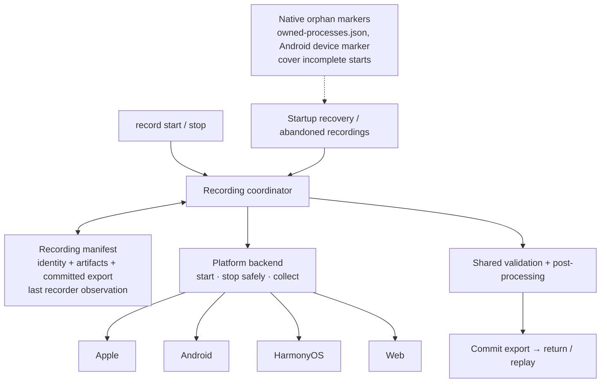

# ADR 0024: Screen Recording — One Coordinator, Two Facts

## Status

Proposed (2026-09-14).
This proposal amends ADR 0019 section 5 only for `screen-recording`.
ADR 0019 receives a short pointer under 2.7, as with ADRs 0022 and 0023.
App-log, audio-probe, and perf-capture retain ADR 0019's contract.
Rule 6 applies its shared mechanism to each kind only through that kind's failed-finish test.

Completed rollout history is in git history.
The current finalizer uses overlay and telemetry only.
After start-trim removal, the contracts no longer contain `invalidTrimRange` or `trimStartMs`.

The design separates two facts: **playable export existence** and **recorder termination**.
A playable export can exist without confirmed termination.
A stopped recorder can still require video collection.
Both combinations are legitimate.
One lifecycle cannot establish both facts.

## Rules at a glance

This ADR proposes a shared contract for six situations.
Platform-specific behavior stays in backends.

| Situation | Proposed shared behavior |
| --- | --- |
| An active owner is alive and holds the fence | Refuse another start without effects on the recording |
| Stop produces a playable export | Commit and return it with the recorder observation |
| Stop produces no export | Preserve recoverable evidence, return the actual error, and leave the manifest `open` |
| An export is already committed | Replay under the same session/device guards without repeated stop work |
| Recorder or native-path disposition remains unresolved after commit | Retain path/identity in the manifest; authorized recovery may settle termination and disposition |
| Artifact cleanup is considered | Require ownership and proof that recoverable output remains protected |

The proposal defines six rules:

1. **Identity uncertainty never discards a usable export by itself.** Failures preserve retryable evidence.
   This replaces the recording policy of refusal on uncertain ownership.
   Storage, transport, cancellation, and manifest-commit failures remain real errors.
   Stop failure is not limited to two reasons.
2. **Backends own all signals.** The coordinator requests safe stop within a budget and receives an observation.
   Signal choice, order, identity checks, and HarmonyOS toggle safety are backend facts.
   Identity probes remain private.
   Proven identity mismatch prohibits signals in every backend.
   Unreadable probes follow backend capability rules under 2.3.
3. **One path stops and exports.** Live and recovered recordings use safe stop, collection, validation, and commit.
   A live handle helps stop the recorder.
   Its absence never selects another algorithm.
4. **The manifest is the sole lifecycle store.** `screen-recording.resource.json` holds identity, artifacts, committed export, and last recorder observation.
   `owned-processes.json` and the Android marker cover only pre-manifest incomplete starts/chunk launches.
   They are not another lifecycle database.
5. **Recovery selects work; the coordinator performs it.** User stop ensures an export.
   Authorized recovery settles unresolved recorders and safe native-path disposition without changing committed exports.
   Recovery enumerates abandoned/unsettled manifests and requests either operation under ownership guards.
   It never independently kills processes or deletes files.
6. **Export failure does not authorize disposal.** Collection, validation, and commit failures preserve retry material.
   Only teardown and failed-start rollback invoke forced cleanup.
   A thrown finish never implies cleanup.
   The shared mechanism belongs to `capture-kit/durable-capture/transitions.ts`.
   Each other durable kind requires its own failed-finish test.
   App-log, audio-probe, and perf-capture must each prove retry requirements.
   A kind that needs no retry material explicitly retains current disposal.
   Android data loss establishes this rule for recording only.

Two later separate steps have independent evidence and remain documented to preserve their rationale:
Android marker-only content (2.6) and API 34+ `--time-limit 0` (2.8).

## 1. Context

Fixes to the single `record start`/`record stop` family have each affected 10 to 35 files over three months.
They are #2447, #2457, #2487, #2534, #2564, #2565, and #2566.
The subsystem has about 10,150 production lines and 19,000 test lines across these areas:

- `contracts`
- `capture-kit`
- `host-kit`
- Four platform packages
- Nine `src/platform-runtime-screen-recording-*` hosts
- Eight daemon modules

Nine record bugs were filed after July 2026.
Five were ownership refusals caused by uncertainty:

| Issue | Refusal | Native cause? |
| --- | --- | --- |
| #2549 | `ps` 1 s probe timed out under load → `cleanup-pending`, session wedged | no |
| #2550 | device manifest `deviceId` ≠ current serial → "recovery evidence already exists" | no |
| #2476 | reused pid → "completed evidence cannot be safely retired" | no |
| #2281 | client window expired → no CLI path to the finished export | no |
| #1117 | daemon lost session state → "no active recording" | no |
| #2170 | CoreSimulator host lock after `SIGKILL` | yes |
| #1651 | validator rejected a static single-frame clip; `moov` patched in place | yes |
| #615 | `screenrecord` 180 s cap | yes |
| #2551 | clip ends at the last screen change | yes |

Three facts make the fail-closed contract more costly than protective:

- **Four of five backends cannot reattach.** `reattachAppleRecording`, HarmonyOS, and web operations always return `unreattachable`.
  After daemon loss, `finishRecoveredDurableCapture` runs descriptor cleanup, then throws even when finalized MP4 output exists.
  Only Android reports `active` or `completed`.
  Ten ownership/outcome enums encode distinctions unavailable to four backends.
- **Daemon loss is rare and already mitigated.** Active recordings prevent idle reap.
  Startup already sends `SIGINT` to orphaned `simctl recordVideo` children from `owned-processes.json`.
  Maintainer logs contain zero recording reattachments.
  Reported failures concern ordinary same-daemon stops.
- **Failed export destroys retry material.** On thrown `finish`, `finishDurableCaptureHandle` calls `handle.forceCleanup()` through `transitions.ts`'s `compensateFailedFinish`.
  Android reaches `cleanupVerifiedAndroidEvidence`, which removes the remote artifact and marker.
  One failed pull under load therefore prevents another pull.

Raw `adb` reproduced #2551 on an API 36 emulator.
`SIGINT` at +16 s produced a last frame at +12.6 s, the last screen change.
Changes after the last input were captured.
`screenrecord`'s change-driven encoding determines clip length, not this stop path.
Disclosure in PR #2566 is the complete fix.

## 2. Decision

### 2.1 Shape

This section proposes the following ownership structure:



The coordinator reuses the existing manifest store, fence, pending-transfer guard, and completed replay from PR #2534.
No new framework is proposed.

### 2.2 The backend contract

This section proposes the following backend interface:

```ts
type RecordingBackend = {
  start(input): Promise<{ handle: LiveHandle; descriptor: Descriptor }>;
  stop(target: LiveHandle | Descriptor, budget: Budget): Promise<StopObservation>;
  collect(descriptor: Descriptor, outputPath: string): Promise<Collected>;
};

type StopObservation =
  | { recorder: 'confirmed' }            // exit or stop acknowledgement observed
  | { recorder: 'unconfirmed'; why }     // identity unreadable, or no exit inside the budget
  | { recorder: 'lost'; why };           // identity proven not ours, or runner/browser session dead
```

`stop` accepts a live handle or persisted descriptor.
It privately determines safe stop behavior:

- Simulator kills its own `ChildProcess` and probes each descendant marker before pid signals.
  It never signals `not-ours`, as #2565 proves.
- Android probes `/proc` before `kill -2`, as current `stopChunk` does.
  Unreadable `/proc` returns `unconfirmed` instead of an exception.
- Runner sends a stop RPC bound to `runnerSessionId`.
- HarmonyOS toggles once through a live handle, never a descriptor.
- Web stops the session browser.

The coordinator does not see this sequence.
Every backend must report `StopObservation.recorder` for the public `recorder` field.
It describes an observation, not identity proof.

Admission facts stay in their current owners.
If a backend sees a foreign live recorder, `screenRecordingStart` reports unavailable with `DEVICE_IN_USE` and the writer's identity:

- Android uses `findRunning` over every `agent-device-recording-*` path, not only the reused path.
- Simulator observes `simctl` exit 16.
- Runner/web use provider active-recording reports.

### 2.3 The coordinator's stop

This section proposes separate ensure-export and recovery-only settle requests.
Ensure-export follows this sequence:

```
record stop  (request: ensure export)
  0. guard: session and device match; fence held
       manifest completed → replay the committed export (no stop work)
       fence lost with an open manifest → ownership-fence-lost
  1. backend.stop(handle ?? descriptor, budget)      → observation  (recorded; not a checkpoint)
  2. backend.collect(descriptor, collectedPath)      → immutable copy, playability sniff passed
                                                                      checkpoint: collected
  3. finalizer: overlay, telemetry: collectedPath → exportPath      checkpoint: finalized
  4. commit: manifest completed { export, recorder observation, native path disposition }; respond
```

**`collect` always creates a separate immutable copy.**
Every recorder owns its native path:

- `simctl` output
- Runner device file
- Android `/sdcard` chunks
- HarmonyOS media item
- Agent-browser WebM

`collect` copies or pulls into `collectedPath`, beside the caller's export path.
The copy receives a checkpoint only after playability validation.
The native path is never the export or an in-place finalization input.
Local collection still copies files.
A playable copy does not prove the native writer stopped.
On simulator/web, that writer can remain `unconfirmed`.

**Backend proof determines native-path disposition at commit.**
After commit, the manifest retains native path and identity until cleanup is proven safe.
Proof is `recorder: 'confirmed'` through exit/acknowledgement, or a later settle that proves the writer `gone`.
`lost` alone never authorizes native-path deletion.
A changed pid identity says nothing about the current writer at that path.
HarmonyOS/web cannot prove writer absence.
They retain native items until explicit fenced disposal under rule 6.
Only the collected copy may be finalized.
Only that copy is removed after commit.
Disposition completes after successful fenced retirement or verified native-artifact absence.
A retirable path still requires its manifest until retirement completes.

**Checkpoints identify valid durable artifacts, never attempts.**
`collected` requires the existing `video.ts` playability check (`ftyp` + `moov`).
A pulled unfinalized MP4 receives no checkpoint.
`finalized` requires written export output.
Step 1 records its observation without a checkpoint.
While `unconfirmed` and before export commit, every retry repeats step 1.
Android therefore probes previously unreadable `/proc` again and signals a recorder that becomes readable.
`confirmed` and `lost` observations do not repeat stop.
After required step-1 work, retry starts at the first missing checkpoint.

The collected copy remains until step 4 commits.
Finalization reads it and writes the export beside it.
A failed-commit retry therefore changes no video.
Current `exportProcessedVideo` applies overlays in place through `overlay.ts` rename-over-input.
PR #2586 removed start trimming.
The separate copy prevents duplicate overlay application after commit failure.
After commit, copy-removal failure is diagnostic only, never a command error.

Failures at any of steps 1-4 leave the manifest `open` with observations, checkpoints, and every artifact preserved.
The next stop repeats the required work.
Simulator step-1 retry already has #2565 evidence.
Rule 6 prohibits forced cleanup here.

After commit, the manifest retains native path, identity, observation, and disposition.
The next `record stop` only replays.
Authorized recovery settles unresolved recorder/disposition under 2.5.
A second stop never repeats that work.

```
settle recorder  (request: recovery only)
  0. guard: fence taken over; manifest open and abandoned, or completed with an
            unresolved recorder or pending native-path disposition
  1. unresolved recorder: backend.stop(descriptor, budget) → observation
     confirmed/lost recorder: do not repeat stop; inspect only pending artifact disposition
  2. completed manifest: persist recorder observation and native-path disposition;
     authorized retirement runs through the backend under the fence only when proven safe;
     a failed retirement leaves disposition pending; the committed export is not touched
     open manifest: continue as ensure export from the recorded phase
```

### 2.4 Start admission

This section proposes the following `record start` order:

1. If the session has a live handle, refuse with `recording already in progress`.
2. If the device has an actively owned `open` manifest, refuse.
   Existing `host-kit/internal/owner-identity.ts` must establish a live owner that holds the fence.
   This ADR 0019 rule remains unchanged.
3. Otherwise, submit the abandoned/completed manifest to recovery under ownership guards before launch.
   Recovery may terminate an `ours` recorder and collect its export into the old session manifest.
   It never deletes evidence without proof of abandonment.
4. Request the backend admission fact.
   A foreign live writer returns `DEVICE_IN_USE` with writer identity.
5. If the current manifest remains unsettled, archive it under its fence generation before adoption.
   Unsettled means `open`, or `completed` with unresolved recorder/disposition.
   Use same-directory atomic rename:
   `screen-recording.resource.json` → `screen-recording.<generation>.resource.json`.
   Extend existing `store.list` session-directory traversal with the archive glob.
   Compute the next generation as the maximum across all directory manifests plus one.
   Do not use only the current file, as current `createNextDurableCaptureFence` does.
6. Launch at a new artifact path with that generation.

Completed manifests, different serials, reused pids, and unreadable process tables become recovery inputs, not start refusals.
Adoption never overwrites potentially necessary recovery evidence.
One current manifest remains per session.
Unsettled predecessors remain durably enumerable by generation.
Archives are removed only after export commit and completed native-path disposition.
Neither `confirmed` nor `lost` alone permits archive retirement.
Stopped writers can leave undisposed artifacts.
Lost identity does not prove disposal safety.
`record stop` and replay read only the current manifest.
Recovery owns archived manifests.

### 2.5 Recovery

This section proposes two recovery entry points with one shared implementation:
daemon startup and admission step 3.
Both enumerate current/archive manifests with `store.list`.
Eligible manifests are abandoned `open`, or `completed` with unresolved recorder/disposition.
For each, recovery acquires the existing fence-takeover ownership guard.
A stale fence remains untouched with a diagnostic.
Recovery asks the coordinator to **settle the recorder** under 2.3.
Confirmed/lost recorders with pending disposition still participate, without another signal.
The backend examines disposition only.

The coordinator persists completed disposition after successful authorized fenced retirement or verified absence.
Until then, enumeration supports retry or explicit teardown.
Committed exports are never recollected, refinalized, or replayed by recovery.
Abandoned open manifests continue ensure-export from their recorded phase.

Recovery never selects signals or deletions itself.
If an open manifest has `lost` recorder identity but playable output, the coordinator commits with `recorder: 'lost'`.
Unplayable output leaves it `open` with evidence and a diagnostic.
`owned-processes.json` retains only its incomplete-start role before any manifest exists.
It prefers `SIGINT` for `simctl` under #2457.

Rule 6 treats disposal as a separate explicit decision.
Teardown/failed-start rollback disposes through the backend under the fence.
First, the manifest must record that no recoverable export is lost.

### 2.6 Native markers

This section proposes narrower marker content without marker removal.
`owned-processes.json` and `/sdcard/agent-device-recording-active.json` cover native launch-to-manifest intervals.
They also cover Android chunk rotation.
The Android marker becomes identity plus pending chunk path.
It stops carrying completion, `deviceId` admission gating, or fence generation as an admission key.
Only backend `stop` and incomplete-start recovery read it.
Deletion remains deferred until the manifest alone proves coverage of launch/rotation crash intervals.

### 2.7 ADR 0019 amendment

This section proposes an amendment, not a current change to ADR 0019.
Current section 5 requires durable-facet `reattach`/`cleanup` and `cleanup-pending` for uncertain cleanup.
`transitions.ts` also forces cleanup after finish failure.
The proposed amendment is:

Screen recording is a **stop-and-collect** resource.
It retains the manifest, destructive-step fences, and completed replay.
Backend `stop(target)`/`collect` replace `reattach`/`cleanup`.
This kind removes the `cleanup-pending` phase and admission ledger.
It records recorder observation beside the committed export.
For every durable kind, failed finish no longer implies forced cleanup.

### 2.8 Android duration (separate decision)

This section proposes a separate later change.
`screenrecord --time-limit 0` removes the cap on API 34+.
API 36 emulator help confirms it; AOSP added it in API 34.
Those devices would use one artifact without rotation.
Below API 34, rotation remains.
Implementation follows 2.1–2.7 but is not their prerequisite.

## 3. Cross-platform matrix

This proposal defines the following backend behavior alongside current daemon-loss behavior:

| Backend | `stop` from a live handle | `stop` from a descriptor (recovery) | `collect` | Today after daemon loss |
| --- | --- | --- | --- | --- |
| iOS / tvOS simulator | `ChildProcess.kill` tiers; descendant markers probed before pid signals | probe markers; signal on ours; `unconfirmed` if the host is silent; `lost` on mismatch | local copy of the `simctl` output file; native file retained until the writer is proven gone | cleanup signals, then **throws** |
| iOS device (CoreDevice), macOS | runner stop RPC bound to `runnerSessionId` | same RPC if the runner session matches; `lost` if the runner restarted | device copy (iOS); local copy of the runner's output file (macOS) | cleanup stops the runner, **never retrieves**, throws |
| Android | probe `/proc`, then `kill -2` → `-9`; `unconfirmed` when `/proc` is unreadable | same, from the pid triple in the descriptor | `adb pull` of every chunk, playability sniff | reattach through the device manifest; five ownership states |
| HarmonyOS | one `aa start` toggle, tracked by the handle | **no signal**; `mediatool query` by file name; `unconfirmed` if found, `lost` if not | stage + `hdc file recv` | `cleanup-pending`, manual |
| Web | provider `record stop` on the session browser | stop if the browser is alive, else `lost` | local copy of the WebM; native file retained while the browser is not proven gone | `cleanup-pending`, manual |
| Limrun (iOS, Android) | provider stop RPC on the live session; the served download URL is memoized so a stop is never repeated | **no signal**: the recording lives and dies with the instance; `unreattachable` | HTTP download of the served MP4 to the output path, bounded by a deadline that ends inside the `record` request window (60 s of its 90 s envelope) and not cancellable; retriable from the memoized URL while the instance lives | `cleanup-pending`, manual; the instance (and its file) is deleted on lease release |
| WebDriver providers, Vega | unavailable | — | — | unchanged |

A blind HarmonyOS toggle starts recording.
Only the live handle may toggle.
Apple runner recordings terminate with the runner process.
After keep-hot restart, `lost` is therefore correct.

## 4. Compatibility

This proposal makes additive changes to published surfaces, with the behavior change identified below:

| Surface | Change | Breaking? |
| --- | --- | --- |
| Node client `RecordingStopCommandResult` | adds optional `recorder` and `capturedDurationMs` | no |
| MCP `record` output schema | two optional properties; required list unchanged | no |
| Daemon RPC (ADR 0006) | optional response fields; no protocol bump; wire ledger `compatibleChanges` entry | no |
| Error `details.reason` `cleanup-unconfirmed`, `resource-missing` | `record stop` stops emitting them; `ownership-fence-lost` stays; the union stays for the other kinds | no |
| CLI exit status | `record stop` after daemon loss on Apple, HarmonyOS, and web exits 0 with a warning where it exited 1 | behavior change, CHANGELOG |
| Runtime operations `screenRecordingReattach` / `screenRecordingCleanup` | removed; workspace-internal | no |
| Persisted manifests | newer daemons read every older shape; older content is recovery input | no |
| Android API < 34 | unchanged | no |

## 5. Tests

This proposal requires the following test changes.

**Keep unchanged:**

- #2565 handle-stop, next-stop retry, and never-signal-reused-pid tests
- #2564 stranded-serial retirement and live-writer refusal
- #2534 replay
- Every fence-loss test
- #2487, #2447, #2457, #1651, and #2566

**Change expected results:**

- #2564 "refuses a stranded interrupted launch whose writers cannot be read" now permits start after recovery preserves evidence.
- "retains open evidence … after its recorder is gone" now commits or retains evidence through recovery, then permits start.
- #2565 "refuses to signal a live process whose identity nobody can read" still sends no signal.
  With playable output, stop completes as `unconfirmed`.
- Apple/HarmonyOS/web post-daemon-loss stop errors become completion with `recorder`, or errors that preserve evidence.

**Before removal, add these tests for every applicable backend:**

- Collection failure invokes no `forceCleanup`.
  Remote artifact and open manifest remain intact.
  A second stop succeeds.
  Current Android behavior deletes this retry material.
  Every durable kind needs its own test that names retry requirements.
  Tests for retained disposal identify that behavior in their names.
- Commit failure after overlay leaves `open`, phase `finalized`, and the collected copy.
  Retry commits without another finalizer call, proven by a spy.
  Export bytes remain identical.
- Simulator/web `unconfirmed` stop leaves a live native writer while the collected copy passes validation.
  Completion serves the copy without changing the open native file.
  Later writer-absence proof marks the native path retirable.
  `lost` alone leaves it intact.
- An `ours` recorder signaled without observed exit completes as `unconfirmed`.
  Next stop replays without a backend call, proven by a spy.
  Startup recovery calls stop and updates to `confirmed` without changing export bytes.
- Android unreadable `/proc` sends no `kill`, pulls the artifact, and reports `unconfirmed`.
  A different process identity sends no `kill` and reports `lost`.
- Android unreadable `/proc` with `moov`-less output leaves no `collected` checkpoint and keeps `open`.
  On readable retry, `kill -2` produces observed exit and a valid new pull with `confirmed`.
  A recorded attempt never proves termination.
- Start with completed/unconfirmed state archives the old generation and allocates generation + 1.
  `store.list` returns both.
  Recovery settles and removes the archive later.
  Adoption never overwrites unresolved evidence.
- Completed/lost state with pending disposition is archived before start.
  Recovery retains path/identity.
  Lost identity alone authorizes no deletion.
  Backend proof and fenced disposition must complete before archive removal.
- Confirmed state with failed native retirement is archived before start.
  Recovery retries only disposition.
  Failure retains the manifest; success permits archive removal.
  Committed export bytes remain unchanged.
- HarmonyOS live stop toggles exactly once.
  Recovery never toggles.
- Actively owned open manifests refuse start.
  Abandoned manifests receive recovery first.
  Old artifacts remain unless committed, and new start uses a new path.
- A live Android writer at an earlier timestamped path causes `DEVICE_IN_USE` with its identity.
- A stale fence with committed output permits replay.
  A stale fence with `open` returns `ownership-fence-lost` without signals.

**Delete:** recording `cleanup-pending` branches, four platform packages' reattach/cleanup units, and Android completed-evidence refusal tests.

## 6. Refuted alternatives

This proposal rejects or defers these alternatives:

- **Continue fail-closed patches.** #2487/#2564/#2565 each add a correct state, but another branch appears within weeks.
- **Remove recording manifests.** Replay needs durable storage.
  Fences prevent stale-owner mutations.
- **Public `probe` + `stop(level)`: rejected.** It transfers signal sequencing to the coordinator and permits live-handle identity bypass.
- **Use `owned-processes.json` for recovery enumeration: rejected.** That duplicates lifecycle storage.
  It retains only incomplete-start recovery.
- **Independent recovery signals/deletions: rejected.** This duplicates coordinator work with weaker guards.
  Recovery selects work; the fenced coordinator performs it.
- **Retire unresolved evidence at start: rejected.** An unproven recorder may still write.
- **Delete Android markers immediately: deferred.** The manifest does not yet cover launch/rotation crash intervals.
- **Remove all rotation: rejected.** Below API 34, that loses all output after 180 s.

## 7. Rollout

This active proposal retains these implementation steps after the completed prerequisite in git history:

2. Implement rule 6 in the shared coordinator with per-kind failed-finish coverage.
   Recording comes first.
   The other three kinds each use a separate commit that identifies retry material.
   This step is independently shippable.
3. Consolidate stop, export, and replay with existing primitives.
   Add 2.3's coordinator stop, response `recorder`/`capturedDurationMs`, recovery under 2.5, and admission under 2.4.
   Remove no operation and move no store.
   This addresses the class behind #2549, #2550, #2476, and #2281.
4. Replace `reattach`/`cleanup` with backend `stop(target)`/`collect`.
   Delete recording's stop-recovery plan, exact-owner recovery control, and admission ledger.
5. Reduce Android marker content under 2.6 with crash-interval tests.
6. Add API 34+ `--time-limit 0` under 2.8.
7. Amend ADR 0019 section 5 and update `commands.md`.

Each step requires independent live proof under ADR 0019:

- iOS simulator
- Android emulator API 34+
- One Android API < 34 image
- macOS runner
- HarmonyOS, if a device is available
- Web

Each backend proves ordinary stop, host-silent stop, post-daemon-loss stop, collection-failure retry, and stale-caller refusal.

## 8. End state

This proposal estimates the following result:

| Area | Before | After step 4 | After step 5 |
| --- | --- | --- | --- |
| `contracts` recording types, ops, plan | 505 | ~350 | ~350 |
| `platform-android/recording` | 1,566 | ~1,100 | ~800 |
| `platform-apple/recording` | 685 | ~450 | ~450 |
| `platform-harmonyos/recording` | 386 | ~300 | ~300 |
| `platform-web/recording` | 171 | ~140 | ~140 |
| nine `src/platform-runtime-screen-recording-*` hosts | 1,325 | ~1,100 | ~1,000 |
| `src/daemon` recording modules | 899 | ~500 | ~500 |
| shared: finalizer, durable-capture, host-kit, commands, layering, Swift | ~4,600 | ~4,600 | ~4,600 |
| **Recording-specific total** | **~10,150** | **~8,500** | **~8,100** |
| Recording test lines | ~19,000 | ~15,000 | ~14,000 |
| Ownership / outcome enums | 10 | 3 | 3 |
| Runtime operations for recording | 3 (start, reattach, cleanup) | 3 (start, stop, collect) | 3 |
| `record stop` paths | 2 (live; recovery that throws on 4 backends) | 1 | 1 |
| Files on an Android stop path | 9 | ~7 | ~6 |

Reduction is limited because device markers, root hosts, and below-34 rotation remain.
The benefit is one path, one store, three enums, and no refusal caused solely by host silence or reused pids.
A later ADR may move nine root hosts into per-platform transports after R16 layering-gate changes.
That structural change is outside this policy and unnecessary for section 1's situations.

The implementation deletion test requires these results:

- Production no longer contains `screenRecordingReattach` or `screenRecordingCleanup`.
- Recording no longer contains `cleanup-pending` or `ScreenRecordingAdmissionLedger`.
- `transitions.ts` has no cleanup-on-failed-finish path.
- Every rules-table situation has a passing test on every applicable backend.
