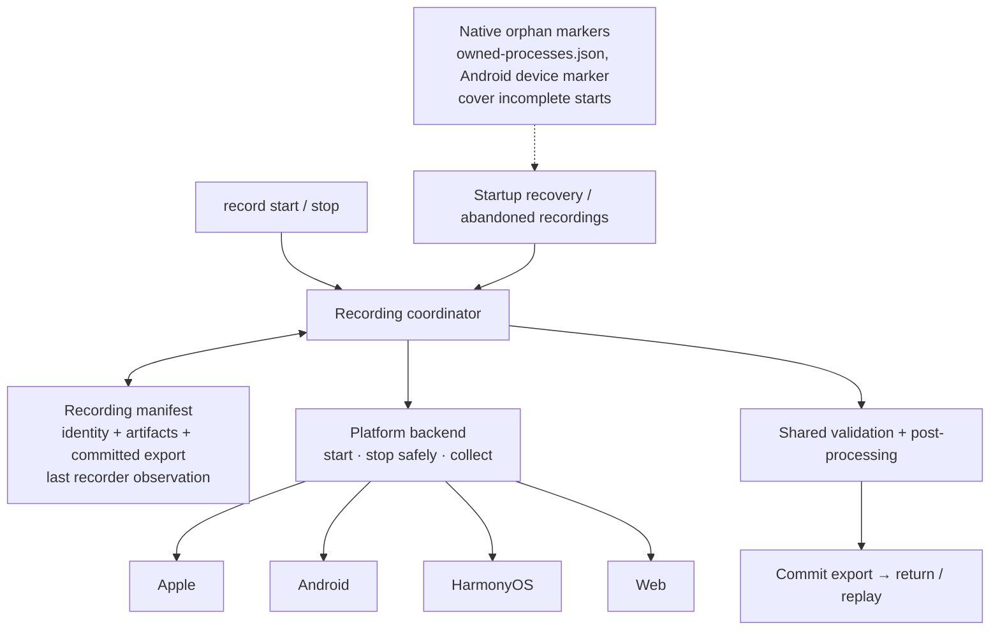

# ADR 0024: Screen Recording — One Coordinator, Two Facts

## Status

Proposed (2026-09-14).
This ADR amends ADR 0019 section 5 for the `screen-recording` resource kind only.
ADR 0019 receives a short pointer paragraph, which section 2.7 of this ADR describes.
ADR 0022 and ADR 0023 have the same relationship to ADR 0019.
App-log, audio-probe, and perf-capture keep the ADR 0019 contract unchanged.
The shared mechanism of rule 6 reaches each of these kinds only through the own failed-finish test of that kind.

Completed rollout history is in git history.
The finalizer uses overlay and telemetry only.
The contracts no longer contain `invalidTrimRange` or `trimStartMs` after removal of start trimming.

Two facts drive the design, and the design keeps them independent:
**whether a playable export exists** and **whether the recorder has stopped**.
A playable export can exist while termination is unconfirmed.
A recorder can be stopped while its video still needs collection.
Both combinations are legitimate, and one lifecycle cannot answer both questions.

## Rules at a glance

The shared contract is six situations.
Everything platform-specific stays in the backend.

| Situation | Shared behavior |
| --- | --- |
| A recording is actively owned (its owner is alive and holds the fence) | Another start refuses without disturbing it |
| Stop produces a playable export | Commit it and return it with the recorder observation |
| Stop cannot produce an export | Preserve recoverable evidence, return the actual error, leave the manifest `open` |
| An export was already committed | Replay it, under the same session and device guards, without repeating stop work |
| The recorder or native-path disposition remains unresolved after a committed export | Retain the native path and identity in the manifest; authorized recovery may settle termination and disposition |
| Artifact cleanup is considered | Require ownership and proof that no recoverable output is destroyed |

Six rules make the table operational:

1. **Identity uncertainty alone never discards a usable export, and failures preserve retryable evidence.**
   This replaces "fail closed on uncertain ownership" as the recording policy.
   It is not "stop fails for exactly two reasons".
   Storage, transport, cancellation, and manifest-commit failures remain real errors.
2. **Signalling lives entirely inside the backend.**
   The coordinator asks "stop safely within this budget" and receives an observation.
   These are backend facts with different meanings for each platform:
   which signal, in which order, after which identity check, and whether a HarmonyOS toggle is safe.
   Identity probes are private to the backend.
   A proven identity mismatch prohibits signalling in every backend.
   The own capability rules of the backend answer an unreadable probe (2.3).
3. **One stop-and-export path.**
   Live and recovered recordings run the same steps: stop safely, collect, validate, commit.
   A live in-process handle helps the backend stop.
   Its absence never selects a different algorithm.
4. **The recording manifest is the only lifecycle store.**
   Identity, artifacts, the committed export, and the last recorder observation live together in `screen-recording.resource.json`.
   `owned-processes.json` and the Android device marker cover only the window before a manifest exists (incomplete starts, chunk launches).
   They are not a second lifecycle database.
5. **Recovery selects work; the coordinator does it.**
   The coordinator serves two requests:
   - A user stop **ensures an export**.
   - Authorized recovery **settles the recorder**.
     It stops an unresolved recorder and completes safe native-path disposition.
     It does not touch a committed export.

   Recovery enumerates abandoned or unsettled manifests, and it asks for one of the two requests under the ownership guard.
   It never kills processes or deletes files on its own.

6. **Export failure is not disposal.**
   A collection, validation, or commit failure preserves the material that a retry needs.
   Only session teardown and failed-start rollback invoke forced cleanup.
   Forced cleanup is never inferred from "finish threw".
   The mechanism is in the shared coordinator (`capture-kit/durable-capture/transitions.ts`).
   But each kind must earn its scope.
   Each of app-log, audio-probe, and perf-capture gets its own failed-finish test that proves what its retry needs.
   A kind whose retry needs nothing keeps its current disposal explicitly.
   The Android data loss alone establishes the rule for recording only.

This ADR records two later, independently proven steps so that nobody re-litigates them:
the reduction of the Android device marker to marker-only content (2.6), and `--time-limit 0` on API 34+ (2.8).

## 1. Context

`record start` / `record stop` is one command family.
But each of its fixes in the last three months touched 10 to 35 files (#2447, #2457, #2487, #2534, #2564, #2565, #2566).
The subsystem has ~10,150 production lines and ~19,000 test lines across these areas:

- `contracts`
- `capture-kit`
- `host-kit`
- four platform packages
- nine `src/platform-runtime-screen-recording-*` hosts
- eight daemon modules

Nine user-facing record bugs were filed since July 2026.
In five of them, the ownership machinery refused because of its own uncertainty:

| Issue | Refusal | Native cause? |
| --- | --- | --- |
| #2549 | `ps` 1 s probe timed out under load → `cleanup-pending`, session wedged | no |
| #2550 | device manifest `deviceId` ≠ current serial → "recovery evidence already exists" | no |
| #2476 | reused pid → "completed evidence cannot be safely retired" | no |
| #2281 | client window expired → no CLI path to the finished export | no |
| #1117 | daemon lost session state → "no active recording" | no |
| #2170 | CoreSimulator host lock after `SIGKILL` | yes |
| #1651 | validator rejected a static single-frame clip; `moov` patched in place | yes |
| #615 | `screenrecord` 180 s cap | yes |
| #2551 | clip ends at the last screen change | yes |

Three facts make the fail-closed contract cost more than it protects:

- **Reattachment is already dead on four of five backends.**
  `reattachAppleRecording` and the HarmonyOS and web operations return `unreattachable` unconditionally.
  After daemon loss, `finishRecoveredDurableCapture` runs descriptor cleanup and then **throws**.
  It throws even when cleanup succeeded and the finalized MP4 is on disk.
  Only Android can answer `active` or `completed`.
  Ten ownership and outcome enums express distinctions that four backends cannot make.
- **Daemon loss mid-recording is rare and already mitigated.**
  An active recording holds off the idle reaper.
  The startup reaper already sends `SIGINT` to orphaned `simctl recordVideo` children from `owned-processes.json`.
  The local daemon logs of the maintainer hold zero recording reattachments.
  All the reported failures are ordinary same-daemon stops.
- **A failed export destroys its own retry.**
  `finishDurableCaptureHandle` calls `handle.forceCleanup()` when `finish` throws (`transitions.ts`, `compensateFailedFinish`).
  On Android, that reaches `cleanupVerifiedAndroidEvidence`, which removes the remote artifact and marker.
  A pull that fails once under load leaves nothing to pull a second time.

`#2551` was reproduced with raw `adb` on an API 36 emulator.
`SIGINT` at +16 s produced a clip whose last frame is at +12.6 s, the last screen change.
Changes after the last input were captured.
The clip length comes from the change-driven encoding of `screenrecord`, not from our stop path.
Disclosure (PR #2566) is the whole fix.

## 2. Decision

### 2.1 Shape



The coordinator reuses the existing manifest store, fence, pending-transfer guard, and completed replay (PR #2534).
There is no new framework.

### 2.2 The backend contract

```ts
type RecordingBackend = {
  start(input): Promise<{ handle: LiveHandle; descriptor: Descriptor }>;
  stop(target: LiveHandle | Descriptor, budget: Budget): Promise<StopObservation>;
  collect(descriptor: Descriptor, outputPath: string): Promise<Collected>;
};

type StopObservation =
  | { recorder: 'confirmed' }            // exit or stop acknowledgement observed
  | { recorder: 'unconfirmed'; why }     // identity unreadable, or no exit inside the budget
  | { recorder: 'lost'; why };           // identity proven not ours, or runner/browser session dead
```

`stop` accepts either the in-process handle or the persisted descriptor.
It decides internally how to stop safely:

- The simulator backend kills its own `ChildProcess`.
  It probes every descendant marker before it signals that marker by pid.
  A `not-ours` marker is never signalled, as #2565 proves.
- The Android backend probes `/proc` before `kill -2`, exactly as `stopChunk` does today.
  When `/proc` is unreadable, it answers `unconfirmed` and does not throw.
- The runner backend issues the stop RPC bound to `runnerSessionId`.
- The HarmonyOS backend toggles once from its live handle, and never from a descriptor.
- The web backend stops the session browser.

None of that sequencing is visible to the coordinator.

`StopObservation.recorder` is the one word that every backend must report.
It fills the public `recorder` field.
It describes what was observed, never what identity proved.

Admission facts stay where they are.
When a backend sees a foreign live recorder, `screenRecordingStart` reports unavailable with `DEVICE_IN_USE` and names the writer:

- Android: `findRunning` over every `agent-device-recording-*` path, not only the one that is about to be reused.
- Simulator: `simctl` exit 16.
- Runner and web: the provider reports an active recording.

### 2.3 The coordinator's stop

```
record stop  (request: ensure export)
  0. guard: session and device match; fence held
       manifest completed → replay the committed export (no stop work)
       fence lost with an open manifest → ownership-fence-lost
  1. backend.stop(handle ?? descriptor, budget)      → observation  (recorded; not a checkpoint)
  2. backend.collect(descriptor, collectedPath)      → immutable copy, playability sniff passed
                                                                      checkpoint: collected
  3. finalizer: overlay, telemetry: collectedPath → exportPath      checkpoint: finalized
  4. commit: manifest completed { export, recorder observation, native path disposition }; respond
```

**`collect` always produces a separate, immutable copy.**
Every backend records into a *native path* that the recorder owns:

- the `simctl` output file;
- the device file of the runner;
- the Android `/sdcard` chunks;
- the HarmonyOS media item;
- the agent-browser WebM.

`collect` copies (or pulls) from the native path into `collectedPath`, a sibling of the export path of the caller.
The checkpoint is recorded when that copy passes the sniff.
The native path is never the export, and it is never finalized in place.
On a local backend, "collect" is a file copy, not "none".
A playable copy does not prove that the native writer has stopped using its path.
On the simulator and web, that writer is exactly the process that the observation may have left `unconfirmed`.

**Native-path disposition is a backend proof, recorded at commit.**
The native path and the recorder identity are retained after commit until the backend proves cleanup safe.
The proof is one of these:

- `recorder: 'confirmed'` (the writer exited or acknowledged);
- a later settle proves the writer `gone`.

A `lost` observation alone never permits deletion of the native path.
A pid identity that no longer matches says nothing about who writes there now.
HarmonyOS and web cannot prove a writer gone.
Thus they retain the native item until an explicit, fenced disposal (rule 6).
Only the collected copy may be finalized, and only the collected copy is removed after commit.
Native-path disposition is complete only after fenced retirement succeeds or the backend verifies that the native artifact is absent.
A path marked retirable still needs its manifest until retirement completes.

**Checkpoints mark durable, valid artifacts; they never mark attempts.**
`collected` is recorded only after the collected copy passes the playability sniff (`ftyp` + `moov`, the existing check in `video.ts`).
Thus a pull of a not-yet-finalized MP4 leaves no checkpoint.
`finalized` is recorded after the export is written.
Step 1 records its observation.
But step 1 is **re-attempted on every retry while the observation is `unconfirmed` and no export is committed**.
For example, an Android `/proc` that was unreadable once is probed again, and a recorder that has since become readable is signalled.
A `confirmed` or `lost` observation is not re-attempted.
A retry resumes at the first missing checkpoint, after it re-runs step 1 when it must.

The collected copy is preserved until step 4 commits.
The finalizer reads it and writes the export beside it.
Thus a retry after a failed commit re-runs nothing that changes the video.
Today, `exportProcessedVideo` applies the touch overlay **in place** (`overlay.ts` renames the processed file over its input; PR #2586 removed start trimming).
That is why the copy is required: without it, a retry after a commit failure would burn the overlay twice.
After commit, the collected copy is removed.
A failed removal is a diagnostic, never an error.

Failures at step 1, 2, 3, or 4 leave the manifest `open`, with the recorded observation, the checkpoints, and every artifact in place.
The next stop re-drives as above.
The step 1 re-drive is what #2565 proves for the simulator today.
No forced cleanup runs on that path (rule 6).

After step 4 commits, the manifest retains the native path, identity, recorder observation, and native-path disposition.
The next `record stop` replays.
Authorized recovery settles any unresolved recorder or pending native-path disposition (2.5).
A second stop never repeats that work.

```
settle recorder  (request: recovery only)
  0. guard: fence taken over; manifest open and abandoned, or completed with an
            unresolved recorder or pending native-path disposition
  1. unresolved recorder: backend.stop(descriptor, budget) → observation
     confirmed/lost recorder: do not repeat stop; inspect only pending artifact disposition
  2. completed manifest: persist recorder observation and native-path disposition;
     authorized retirement runs through the backend under the fence only when proven safe;
     a failed retirement leaves disposition pending; the committed export is not touched
     open manifest: continue as ensure export from the recorded phase
```

### 2.4 Start admission

`record start` runs in this order:

1. If the session already holds a live handle, refuse (`recording already in progress`).
2. If the recording manifest of the device is `open` and **actively owned**, refuse.
   Actively owned means: the owner named in the manifest is alive by the existing owner-identity check (`host-kit/internal/owner-identity.ts`), and that owner holds the fence.
   This is the ADR 0019 rule, and it is unchanged.
3. Otherwise, the manifest is abandoned or completed.
   Hand it to recovery (2.5) under the ownership guard **before** launch.
   Recovery may end an `ours` recorder and collect its export into the manifest of the old session.
   It never deletes what it cannot prove abandoned.
4. Ask for the admission fact of the backend.
   A foreign live writer is `DEVICE_IN_USE`, and the error names the writer.
5. The current manifest of the session can still be unsettled after recovery:
   `open`, or `completed` with an unresolved recorder or pending native-path disposition.
   In that case, **archive it under its fence generation** before adoption:
   - Rename `screen-recording.resource.json` to `screen-recording.<generation>.resource.json`.
     This is an atomic rename in the same session directory.
   - The store lists both shapes.
     `store.list` already walks session directories, and it gains the glob.
   - The next fence generation is the maximum over every manifest in the directory, plus one.
     It is not the current file plus one, as `createNextDurableCaptureFence` computes today.
6. Launch under a new artifact path and that fence generation.

These no longer refuse a start: a completed manifest, a manifest that names another serial, a reused pid, or an unreadable process table.
They are recovery inputs, not admission inputs.
Adoption never overwrites a manifest that recovery could still need.
The one-file-per-session layout stays for the *current* recording.
Unsettled predecessors remain durably enumerable by generation.
An archived manifest is removed only after its export is committed and its native-path disposition is complete.
Neither `confirmed` nor `lost` alone retires that recovery record.
A stopped writer can leave an artifact that awaits disposal, and a lost identity does not prove disposal safe.
`record stop` and replay read only the current manifest.
Archived manifests belong to recovery.

### 2.5 Recovery

Recovery has two entry points and one body.
At daemon start, and at step 3 of admission, it enumerates manifests (`store.list`, already present; current and archived generations).
It selects manifests in one of these states:

- `open` and not actively owned;
- `completed` with an unresolved recorder or pending native-path disposition.

For each manifest, recovery acquires the ownership guard (the existing fence takeover).
It leaves a stale fence alone with a diagnostic.
Then it asks the coordinator to **settle the recorder** (2.3).
A confirmed or lost recorder with pending disposition still participates.
In that case, the backend inspects artifact disposition and does not signal again.
The coordinator persists disposition after authorized, fenced retirement succeeds or the backend verifies that the artifact is absent.
Until then, the manifest remains enumerable for retry or explicit teardown.
The committed export is never re-collected, re-finalized, or replayed.
An open abandoned manifest continues as ensure-export from the recorded phase.

Therefore, recovery never decides signals or deletions itself.
An `open` manifest whose backend answers `lost` and whose artifact is playable is committed as an export with `recorder: 'lost'`.
An `open` manifest whose artifact is unplayable stays `open`, with its evidence retained and a diagnostic.
The existing `owned-processes.json` reaper keeps its narrow job:
native children left behind by an incomplete start, before any manifest existed.
It prefers `SIGINT` for `simctl` (#2457).

Artifact cleanup is a separate, explicit decision (rule 6).
Session teardown and failed-start rollback dispose through the backend under the fence.
They do this only after the manifest records that no recoverable export is lost.

A leased session's teardown that commits an export at a remote temp path registers it, and its telemetry, as downloadable artifacts of the lease's tenant (rule 1, #2281).
The inventory names the session, and the usual delete-after-download and 15-minute expiry apply.
A later `record stop` replay of that manifest serves the same artifact ids.
If registration fails, teardown deletes the files.
A failed teardown finish still runs forced cleanup (disposal intent) and registers nothing.

### 2.6 Native markers

These markers cover the windows between the spawn of a native recorder and the publication of the manifest that names it:

- `owned-processes.json` covers simulator recorders.
- `/sdcard/agent-device-recording-active.json` covers Android launch and chunk rotation.

The markers stay.
Their content changes.
The Android device marker stops carrying lifecycle (completion, `deviceId` gating, fence generation as an admission key).
It becomes identity plus pending chunk path.
Only the `stop` of the Android backend and its incomplete-start recovery read it.
Its full deletion is deferred until the launch and rotation crash windows are shown to be covered by the manifest alone.

### 2.7 ADR 0019 amendment

Section 5 currently has these requirements:

- Every durable facet exposes `reattach` and `cleanup`.
- Uncertain cleanup stays `cleanup-pending`.
- When finish throws, forced cleanup runs (in `transitions.ts`).

The proposed amendment:
*Screen recording would be a **stop-and-collect** resource.
It would keep the manifest, the fence on every destructive step, and the completed replay.
Backend `stop(target, budget)` and `collect` would replace the `reattach` and `cleanup` facet operations.
This kind would remove the `cleanup-pending` phase and admission ledger.
It would record the recorder observation and native-path disposition beside the committed export.
A manifest would remain archived by fence generation until both are settled.
For each durable kind, failed finish would no longer imply forced cleanup once its failed-finish test states its retry requirements.
App-log, audio-probe, and perf-capture would retain the ADR 0019 contract unchanged.*

### 2.8 Android duration (separate decision)

`screenrecord --time-limit 0` removes the cap on API 34 and later (help text, API 36 emulator; AOSP added the option in API 34).
On those devices, there is one artifact and no rotation.
Below API 34, rotation stays.
This step comes after 2.1–2.7, and 2.1–2.7 do not require it.

## 3. Cross-platform matrix

| Backend | `stop` from a live handle | `stop` from a descriptor (recovery) | `collect` | Today after daemon loss |
| --- | --- | --- | --- | --- |
| iOS / tvOS simulator | `ChildProcess.kill` tiers; descendant markers probed before pid signals | probe markers; signal on ours; `unconfirmed` if the host is silent; `lost` on mismatch | local copy of the `simctl` output file; native file retained until the writer is proven gone | cleanup signals, then **throws** |
| iOS device (CoreDevice), macOS | runner stop RPC bound to `runnerSessionId` | same RPC if the runner session matches; `lost` if the runner restarted | device copy (iOS); local copy of the runner's output file (macOS) | cleanup stops the runner, **never retrieves**, throws |
| Android | probe `/proc`, then `kill -2` → `-9`; `unconfirmed` when `/proc` is unreadable | same, from the pid triple in the descriptor | `adb pull` of every chunk, playability sniff | reattach through the device manifest; five ownership states |
| HarmonyOS | one `aa start` toggle, tracked by the handle | **no signal**; `mediatool query` by file name; `unconfirmed` if found, `lost` if not | stage + `hdc file recv` | `cleanup-pending`, manual |
| Web | provider `record stop` on the session browser | stop if the browser is alive, else `lost` | local copy of the WebM; native file retained while the browser is not proven gone | `cleanup-pending`, manual |
| Limrun (iOS, Android) | provider stop RPC on the live session; the served download URL is memoized so a stop is never repeated | **no signal**: the recording lives and dies with the instance; `unreattachable` | HTTP download of the served MP4 to the output path, bounded by a deadline that ends inside the `record` request window (60 s of its 90 s envelope) and not cancellable; retriable from the memoized URL while the instance lives | `cleanup-pending`, manual; the instance (and its file) is deleted on lease release |
| WebDriver providers, Vega | unavailable | — | — | unchanged |

Two traps stay visible:

- A blind HarmonyOS toggle **starts** a recording.
  Thus only the live handle may toggle.
- The Apple runner recording dies with the runner process.
  Thus `lost` after a keep-hot restart is correct, and it is not a state to defend against.

## 4. Compatibility

Every published surface changes additively.

| Surface | Change | Breaking? |
| --- | --- | --- |
| Node client `RecordingStopCommandResult` | adds optional `recorder` and `capturedDurationMs` | no |
| MCP `record` output schema | two optional properties; required list unchanged | no |
| Daemon RPC (ADR 0006) | optional response fields; no protocol bump; wire ledger `compatibleChanges` entry | no |
| Error `details.reason` `cleanup-unconfirmed`, `resource-missing` | `record stop` stops emitting them. `ownership-fence-lost` stays. The union stays for the other kinds. | no |
| CLI exit status | `record stop` after daemon loss on Apple, HarmonyOS, and web exits 0 with a warning where it exited 1 | behavior change, CHANGELOG |
| Runtime operations `screenRecordingReattach` / `screenRecordingCleanup` | removed; workspace-internal | no |
| Persisted manifests | newer daemons read every older shape; older content is recovery input | no |
| Android API < 34 | unchanged | no |

## 5. Tests

**Keep as written**:

- #2565's handle-stop, next-stop re-drive, and never-signal-a-reused-pid tests;
- #2564's stranded-serial retirement and live-writer refusal;
- #2534's replay;
- every fence-loss test;
- #2487, #2447, #2457, #1651, #2566.

**Flip**:

- #2564 "refuses a stranded interrupted launch whose writers cannot be read" → the start proceeds after recovery retains the evidence.
- "retains open evidence … after its recorder is gone" → recovery commits or retains it, then the start proceeds.
- #2565 "refuses to signal a live process whose identity nobody can read" → still no signal.
  When a playable file exists, the stop completes as `unconfirmed`.
- Every post-daemon-loss `record stop` error on Apple, HarmonyOS, and web → a completion with `recorder`, or an error that leaves evidence in place.

**Add before removing anything** (one per backend where the row applies):

- Finish fails at collect → no `forceCleanup`.
  The remote artifact and the manifest are intact, and the manifest is `open`.
  The second stop succeeds.
  (Rule 6; today this deletes the Android artifact.)
  There is one such test for each durable kind, and each test states what its retry needs.
  A kind that keeps disposal says so in the test name.
- Commit fails after finalize (overlay applied) → the manifest is `open` at phase `finalized`, and the collected copy is present.
  The retry commits without another finalizer call (spy).
  The export is unchanged byte-for-byte.
- Simulator and web: stop returns `unconfirmed` while the native writer is still alive, and the collected copy passes the sniff.
  → The completion is `unconfirmed`, and the export is served from the copy.
  The native file is untouched and still open by the writer.
  A later settle that proves the writer gone records the native path as retirable.
  A `lost` observation alone leaves it in place.
- `ours` signalled, no exit inside the budget → the completion is `unconfirmed`.
  The next stop replays without a call to the backend (spy).
  Startup recovery calls the backend stop and rewrites the observation to `confirmed`.
  The export file is unchanged.
- Android stop with `/proc` unreadable → no `kill` sent, artifact pulled, `unconfirmed`.
  Android stop with `/proc` that names another process → no `kill`, `lost`.
- Android stop with `/proc` unreadable and a pull that returns a `moov`-less file → no `collected` checkpoint, and the manifest is `open`.
  On the retry, `/proc` is readable → `kill -2` sent, exit observed, the re-pull passes the sniff, and the completion is `confirmed`.
  A recorded attempt never implies termination.
- Start over a session whose manifest is `completed` with `recorder: 'unconfirmed'` → the manifest is archived under its generation.
  The new manifest gets generation + 1, and `store.list` returns both.
  Recovery later settles the archived one and removes it.
  Adoption never overwrites unresolved evidence.
- Completed export with a `lost` recorder and native disposition still pending → start archives the manifest.
  Recovery retains its path and identity, and `lost` alone authorizes no native deletion.
  The archive is retired only after backend proof and fenced disposition complete.
- Confirmed recorder with a failed native-artifact retirement → start archives the manifest.
  Recovery still enumerates it and retries only disposition.
  A failed retry retains the manifest, and a successful retry permits archive removal.
  The committed export is unchanged throughout.
- HarmonyOS live stop issues exactly one toggle.
  Recovery issues none.
- Start over an actively owned open manifest → refused.
  Start over an abandoned one → recovery runs first.
  The old artifact is retained unless committed, and the start proceeds under a new path.
- Start with a live writer on a previous timestamped Android path → `DEVICE_IN_USE` that names it.
- Stale fence with a committed completion → replay.
  Stale fence with an `open` manifest → `ownership-fence-lost`, and no signal is sent.

**Delete**: `cleanup-pending` phase branches for recording, reattach/cleanup unit tests in the four platform packages, and Android completed-evidence refusal tests.

## 6. Refuted alternatives

- **Keep fail-closed, keep patching evidence branches.**
  This is the current trajectory (#2487, #2564, #2565).
  Each patch is correct and adds a state, and the next branch arrives within weeks.
- **Delete the daemon manifest for recording.**
  The replay needs a durable home.
  The fence is what keeps a stale owner from mutating a resource that it no longer holds.
- **A public `probe` + `stop(level)` backend interface.**
  Rejected: it exposes signal sequencing that the coordinator must not own, and a live handle could bypass the identity check.
- **`owned-processes.json` as the sweep list.**
  Rejected: it is a second lifecycle database beside the manifest.
  It keeps its incomplete-start job only.
- **Recovery that signals and deletes on its own.**
  Rejected: it duplicates the coordinator under weaker guards.
  Recovery selects work; the coordinator does it under the fence.
- **Retire unresolved evidence at start.**
  Rejected: an unprovable recorder may still be writing.
- **Delete the Android device marker now.**
  Deferred: it covers launch and rotation crash windows that the manifest does not yet cover.
- **Drop chunk rotation everywhere.**
  Rejected: below API 34, that loses everything after 180 s.

## 7. Rollout

The completed first step is in git history.
These steps remain:

2. Rule 6 in the shared coordinator, gated for each kind:
   a failed finish no longer runs forced cleanup for a kind once the failed-finish test of that kind states what its retry needs.
   Recording comes first.
   The other three kinds each come in their own commit.
   This step is independently shippable.
3. Consolidate **stop, export, and replay** with existing primitives:
   the coordinator stop of 2.3, `recorder` and `capturedDurationMs` on the response, recovery through the coordinator (2.5), and the admission order of 2.4.
   No operation is removed, and no store is moved.
   This step closes the class behind #2549, #2550, #2476, #2281.
4. Replace `reattach` / `cleanup` with backend `stop(target)` / `collect`.
   For recording, delete the stop-recovery plan, the exact-owner recovery control, and the admission ledger.
5. Reduce the Android device marker to marker-only content (2.6), with the crash-window tests.
6. `--time-limit 0` on API 34+ (2.8).
7. Amend ADR 0019 section 5, and update `commands.md`.

Each step is independently proven live under the ADR 0019 evidence rules on these targets:

- iOS simulator;
- Android emulator API 34+ and one API < 34 image;
- macOS runner;
- HarmonyOS, if a device is available;
- web.

Each backend proves the ordinary stop, the host-silent stop, the post-daemon-loss stop, the collect-failure retry, and the stale-caller refusal.

## 8. End state

| Area | Before | After step 4 | After step 5 |
| --- | --- | --- | --- |
| `contracts` recording types, ops, plan | 505 | ~350 | ~350 |
| `platform-android/recording` | 1,566 | ~1,100 | ~800 |
| `platform-apple/recording` | 685 | ~450 | ~450 |
| `platform-harmonyos/recording` | 386 | ~300 | ~300 |
| `platform-web/recording` | 171 | ~140 | ~140 |
| nine `src/platform-runtime-screen-recording-*` hosts | 1,325 | ~1,100 | ~1,000 |
| `src/daemon` recording modules | 899 | ~500 | ~500 |
| shared: finalizer, durable-capture, host-kit, commands, layering, Swift | ~4,600 | ~4,600 | ~4,600 |
| **Recording-specific total** | **~10,150** | **~8,500** | **~8,100** |
| Recording test lines | ~19,000 | ~15,000 | ~14,000 |
| Ownership / outcome enums | 10 | 3 | 3 |
| Runtime operations for recording | 3 (start, reattach, cleanup) | 3 (start, stop, collect) | 3 |
| `record stop` paths | 2 (live; recovery that throws on 4 backends) | 1 | 1 |
| Files on an Android stop path | 9 | ~7 | ~6 |

The reduction is modest, because the device marker stays, the root host files stay, and rotation stays below API 34.
What this design buys is one path, one store, three enums, and no refusal that a silent host or a reused pid can produce.
A later, separate ADR may fold the nine root host files into per-platform transports once the layering gates (R16) are re-cut.
That is shape, not policy, and no row of the table in section 1 needs it.

Deletion test:

- `screenRecordingReattach`, `screenRecordingCleanup`, `cleanup-pending` for recording, and `ScreenRecordingAdmissionLedger` no longer exist in production.
- `transitions.ts` has no cleanup-on-failed-finish path.
- Every situation in the rules table has a passing test on every backend where it applies.
