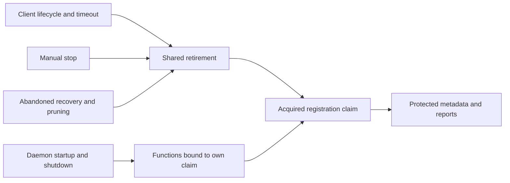

# Process lock exclusion

## Status

Accepted for the hardened host-kit protocol.
Mixed access with the legacy host-kit protocol is unsupported.

## Rules at a glance

- Publication, reclaim, and release hold the same mutation guard without expiry.
- The guard covers only filesystem compare-and-mutate steps.
  Owner liveness is determined before guard acquisition.
  Under the guard, reclaim only confirms that the evaluated record is unchanged.
- Release waits a bounded time for a held guard.
  If the guard is still held after that bound, release remains unverified.
  An unprovable owner record or an unremovable directory also leaves release unverified.
- A claim identifies an acquisition.
  A PID alone cannot authorize release.
- Unknown owners and abandoned guards remain retained.
  Age never proves abandonment.
- Before an upgrade, stop every legacy process that uses the shared state or cache paths.
  While hardened users operate those paths, prevent legacy versions from returning.
  Use one deployed version or separate environments.
  Lock deletion is not an upgrade procedure.
- Manual guard recovery requires external confirmation that every user of the guard's paths has stopped.

[`process-lock.ts`](../../packages/host-kit/src/internal/process-lock.ts) and sibling tests own the implementation and executable invariants.

## Why the guard does not expire

A process can pause after directory creation or dead-claim verification.
Guard expiry admits another process.
The first process can then resume and overwrite or delete the replacement.
Retention of an uncertain guard sacrifices automatic crash recovery to preserve exclusion.

The guard is an exclusive file at the existing guard path.
Legacy age-based `rmdir` cannot remove it.
A new legacy reclaimer therefore cannot take a hardened publisher's guard.
However, this does not revoke a legacy reclaimer admitted before cutover.
Another legacy process may already have stolen its directory guard.
A real paused-child experiment reproduced both protocols returning acquired after the old reclaimer resumed.
Quiescence must include every legacy user.
Continued mixed access remains unsupported.

A different lock path would divide exclusion.
Version checks, owner re-reads, and new guards cannot constrain legacy code after its final check.
The support boundary therefore requires deployment control.
Host-kit does not claim detection or eviction of every legacy user.

Daemon registration has a separate cutover boundary.
It keeps the same `daemon.lock` path.
It refuses legacy files instead of reclaiming them automatically.
A legacy daemon creates an exclusive file.
A hardened daemon creates a directory at that same path.
Old acquisition cannot unlink a directory.
New acquisition retains an existing file.

[Registration tests](../../src/__tests__/daemon-registration-owner.test.ts) use real children with the c237027737 legacy acquisition and current owner.
They cover these cases:

- An older running daemon.
- A hardened owner before metadata publication.
- Concurrent startup.

The client refuses older registration before a signal or modification.
This proves the daemon cutover.
It does not expand the host-kit mixed-protocol support contract.
Older clients still require the deployment controls above.

## Recovering retained legacy daemon state

1. Stop every daemon and client that uses the affected state directory, including older versions.
2. Verify that those processes exited.
3. Keep them stopped throughout recovery.
4. Only then remove the legacy `daemon.lock` file and any retained `daemon.reclaim.lock` guard from that directory.
5. Preserve other state, logs, and repair evidence.
6. Start one supported version with that directory.
7. Prevent older clients or daemons from returning.

If you cannot identify and stop every user, retain the files.
In that case, use a separate state directory.
This procedure applies to daemon registration.
Shared build/cache locks require the same confirmation for every process that uses their paths.

## Registration operations

[Shared retirement](../../packages/daemon-contracts/src/daemon-registration-owner.ts) owns verified termination, protected metadata inspection/removal, and release.
These operations await its result:

- Takeover.
- Failed startup.
- Replay cleanup.
- Timeout reset.
- Manual stop.

Abandoned recovery uses the same protected retirement sequence without a signal to a live process.
Daemon publication and shutdown use functions bound to their acquired claim.

